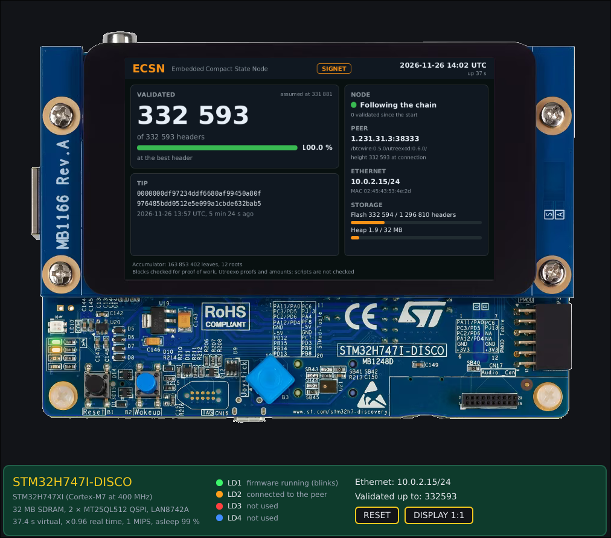

# ecsn-emu-disco

The STM32H747I-DISCO emulated, to run and debug the ECSN firmware (`../firmware`) without the
board: its ELF runs on the STM32H7 of [stm32h7-rax](https://github.com/GPTechinno/stm32h7-rax)
with the board around it, in a window or headless.



The window shows the board, from the photograph of its front on ST's product page, with what the
firmware's display shows in the display's place and its four user LEDs shining where they are lit;
under it what the LEDs mean (LD1 blinks while the firmware runs, LD2 is on while connected to the
peer, LD3 and LD4 are not used), the board's address, the validated tip, the emulation's pace,
RESET and DISPLAY 1:1 (the display alone, at its size); beside them the firmware's defmt logs,
scrolled sideways by the bar under them, a sideways scroll, or Shift and the wheel.

## The board

- The STM32H747XI's Cortex-M7 at 400 MHz, its clock tree, GPIO, timers, RNG, FMC, QUADSPI, Ethernet
  MAC and DMA, LTDC and DSI host (stm32h7-rax, on [rax](https://github.com/Georges760/rax)'s
  Cortex-M core).
- 32 MB SDRAM at `0xD000_0000`.
- Two MT25QL512 in dual-flash mode, 128 MB: the chain store. The flash is kept in a file across
  runs, so a run resumes the chain the last one left, as the board does after a reboot.
- The LAN8742A on MDIO, and a network behind it: [esp32s3-rax](https://github.com/GPTechinno/esp32s3-rax)'s
  router, with DHCP (the board gets 10.0.2.15), DNS to the host's resolver, and NAT for TCP and UDP
  through host sockets; the gateway 10.0.2.2 is the host's 127.0.0.1.
- The display on the DSI link: an OTM8009A, or an NT35510 (`--panel nt35510`), showing what the
  LTDC sends while the panel is awake and on and its backlight lit.
- The four user LEDs, RESET, and defmt over RTT.

## Running

Its own workspace and devenv (nightly Rust for BLIT, the fonts, the Wayland libraries). Build the
firmware with its peer first (see `../README.md` for the build variables), then:

```sh
cd ../firmware && ECSN_NETWORK=signet ECSN_ASSUME_UTREEXO=1 ECSN_PEER=1.231.31.3:38333 cargo build --release
cd ../ecsn-emu-disco && cargo run --release                          # the window
cargo run --release -- --headless --seconds 30 --realtime --volatile  # logs on stdout
```

| Option | |
|---|---|
| `--elf <ELF>` | the firmware, `../firmware/target/thumbv7em-none-eabihf/release/ecsn-firmware` by default |
| `--qspi <FILE>` | the flash image, read at the start (an erased flash if missing) and written at the end and at each RESET; `$XDG_DATA_HOME/ecsn-emu-disco/qspi.bin`, or `~/.local/share/ecsn-emu-disco/qspi.bin`, by default. The chain store is for the network the firmware was built for: a firmware for another network takes another file |
| `--volatile` | an erased flash, saved nowhere |
| `--panel <PANEL>` | `otm8009a` (the default), `nt35510`, or `none` |
| `--headless` | no window: the logs, the emulator's notes and the network events on stdout, then the statistics |
| `--seconds <S>` | the virtual time a headless run lasts, 10 s by default |
| `--realtime` | headless, virtual time no faster than the wall clock (for real peers); the window always paces so. A board fallen behind, its core busy, does not catch up |
| `--screen-png <PNG>` | headless, what the display shows at the end |
| `--profile <S>` | sample the PC every millisecond, and print the busiest functions with their callers every this many seconds and at the end |
| `--trace` | the PC and the core clock every millisecond |
| `--mmio-trace <START:END>` | every peripheral access in a range of addresses, in hexadecimal |

Ctrl-C (or SIGTERM) ends a headless run as `--seconds` does: the statistics, the profile, the flash
image saved.

## Licence

MIT or Apache-2.0. The board's photograph (`assets/stm32h747i-disco.avif`, and the PNG made from it)
is STMicroelectronics', from its product page.
